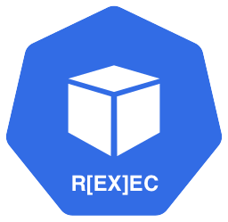

# kubectl-rexec


Kubectl exec does not provide any kind of audit of what is actually done inside the container. The Rexec plugin is here to help with that.

## Contributing
We strongly encourage you to contribute to our repository. Find out more in our [contribution guidelines](https://github.com/Adyen/.github/blob/main/CONTRIBUTING.md)

## Requirements
In Kubernetes 1.30, the `TranslateStreamCloseWebsocketRequests` feature gate is enabled by default, making WebSocket the protocol between kubectl and kube-apiserver instead of SPDY. This solution handles only WebSockets, so the k8s cluster has to be either 1.30 or 1.29 with the `TranslateStreamCloseWebsocketRequests=true` feature flag. Versions below 1.29 are not supported.

## Installation
See the [Getting started](https://github.com/Adyen/kubectl-rexec/blob/main/STARTED.md) guide.

## Usage
See the [Getting started](https://github.com/Adyen/kubectl-rexec/blob/main/STARTED.md) guide.

## Testing
Run the unit and regression tests:

```sh
go test ./...
```

Run the complete exec contract suite in a disposable Kind cluster:

```sh
./scripts/e2e.sh
```

CI runs that suite against the oldest and newest supported Kubernetes versions. See [TESTING.md](TESTING.md) for the covered behavior and local prerequisites.

## Documentation
See the [Design](https://github.com/Adyen/kubectl-rexec/blob/main/DESIGN.md).

## Support
If you have a feature request, or spotted a bug or a technical problem, create a GitHub issue.

## License    
MIT license. For more information, see the LICENSE file.